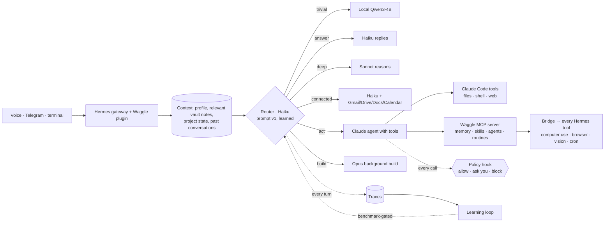

# Waggle 🐝

A personal AI operating system that runs on my own Windows PC. It talks with me by voice or Telegram,
**does things** with real tools (files, shell, browser, mouse and keyboard, email, the web), remembers me and my
projects in an Obsidian vault, works on schedules while I'm away, and **gets measurably better from its own
history**, without spending a cent beyond my Claude plan.

> Named after the honeybee *waggle dance*: how a bee tells the hive where to go. Routing, basically.

It is built on [Hermes Agent](https://github.com/NousResearch/hermes-agent) (gateway, voice, cron, 38 tools,
200+ skills) and borrows the architecture of [OpenJarvis](https://github.com/open-jarvis/OpenJarvis)
(intelligence / engine / agents / tools+memory / learning), adapted for one person and a $0 budget.

## What a message does



- **Router** (Haiku, ~3 s): answers most things itself, sends hard reasoning to Sonnet, email/Drive to a connector
  call, anything that needs *doing* to a tool agent, and big builds to Opus in the background. Its prompt is
  versioned and was improved by the learning loop (see below).
- **Tool agents** are headless Claude Code runs with Claude's own tools plus Waggle's MCP server. Through a small
  bridge inside the Hermes gateway they can call every Hermes tool, so "open Chrome and go to the FTC manual",
  "find my syllabus PDF and tell me when the final is", or "every weekday at 6:45, remind me to pack the robot
  batteries" all just work.
- **Specialists**: coder, researcher (multi-source, written to the vault), robotics (FTC), planner, tutor, monitor,
  each with its own instructions, model and isolated memory, able to delegate to each other.

## Safety: a policy hook, not a prompt

Every tool call any Claude agent makes passes a Claude Code `PreToolUse` hook (`waggle/policy.py`), so a prompt
injection in a web page or email cannot talk its way past it.

| Runs on its own | Asks me first (one-time approval, "yes" grants exactly that call) | Never |
|---|---|---|
| reading files, web search, edits + scripts + installs inside my project folders, Gmail reading and drafts | deleting my files, writing outside my folders, sending/posting/sharing as me, money, secrets files, system-wide installs, registry/system settings, controlling banking or messaging apps | turning off Defender or the firewall, piping downloads into a shell, reading saved browser passwords |

Secrets are redacted from every log, trace and audit entry; untrusted content (web, email, screen text) is
wrapped and scanned for injection; every decision lands in `~/.waggle/audit.jsonl`.

## It learns, measurably

OpenJarvis's trace → learn → eval loop, sized for one person:

1. **Traces**: every turn, tool step, error, latency and token count (redacted). Corrections are captured from the
   conversation itself ("no, I meant…" marks the previous answer wrong; "perfect, thanks" marks it right).
2. **Analysis**: corrections, failing tools, approvals I keep granting, slow routes, things it said it couldn't do.
3. **Skill discovery**: recurring successful tool sequences and repeated requests become skill candidates, which
   Claude writes up as new skills (versioned, with rollback).
4. **Prompt optimisation**: a GEPA-style reflective step rewrites the router prompt from its misroutes and is
   deployed **only** if it beats the current prompt on the tuning set without losing on a held-out set.

First live run (2026-11-18): router accuracy **85% → 97.5%** on the tuning set and **85% → 100%** held-out, deployed as
prompt v1. Safety code and rules are outside what learning can change.

## Skills, models, memory

- **Skills**: one registry over 224 Agent Skills (Hermes bundled + 140 official optional + my own Claude skills +
  Waggle-made). Agents search and load them on demand; every skill's scripts are statically audited; community
  skills (skills.sh, GitHub, ClawHub) are installed through Hermes's scanner and marked unreviewed.
- **Models**: a catalogue built from the real hardware (RTX 5070 12 GB) and Ollama's own metadata (context,
  vision, tool calling, fits-GPU), plus the Claude models; engine adapters for Ollama, any OpenAI-compatible
  server (llama.cpp, vLLM, SGLang, LM Studio) and the Claude CLI, with a fallback chain.
- **Memory**: Obsidian vault + local embeddings; structured project notes (goal, focus, open problems, next
  actions, decisions, log); facts learned from my own words only; past conversations recalled when I refer to them.

## Always on

| | |
|---|---|
| Voice | "waggle" wake word, continuous conversation, Kokoro (Daniel) replies ~0.8 s, natural "one sec" fillers |
| Phone | Telegram chat + iPhone push alarms for critical things (ntfy); Twilio calls when set up |
| Proactive | hourly project watch, morning brief, digests, nightly project review, weekly review, user-defined routines |
| Command Center | `http://127.0.0.1:8897`: health, budget, activity, approvals, agents, routines, learning, skills, memory |
| Obsidian HQ | live Waggle HQ note + canvas inside the vault |
| Recovery | builds interrupted by a crash or reboot resume themselves; `waggle doctor` checks everything |

## Run it

```
python install.py --cron      # plugin, cron jobs, Obsidian theme, skill index (backs up Hermes config first)
.\reload-waggle.ps1           # after pulling changes
python -m waggle.cli doctor   # health check with fixes
python -m waggle.cli bench    # routing benchmark (real Haiku calls)
python -m pytest -q           # 187 tests, no network, no real Claude calls
```

More: [docs/ARCHITECTURE.md](docs/ARCHITECTURE.md) · [docs/BENCHMARK.md](docs/BENCHMARK.md) ·
[overnight/](overnight/) (the build log of the big upgrade).

## Honest limits

- Runs only while the PC is on. Claude Max limits aren't published; the budget is an estimate that recalibrates
  on every real limit hit, and background work stops well before it.
- A tool-agent turn takes 7-15 s (Claude Code start-up + tool calls); voice fills the gap with a short "on it".
- The routing benchmark is 60 hand-labelled requests; good for catching regressions, not a scientific result.
- Image/video generation is off: every provider for it costs money.
