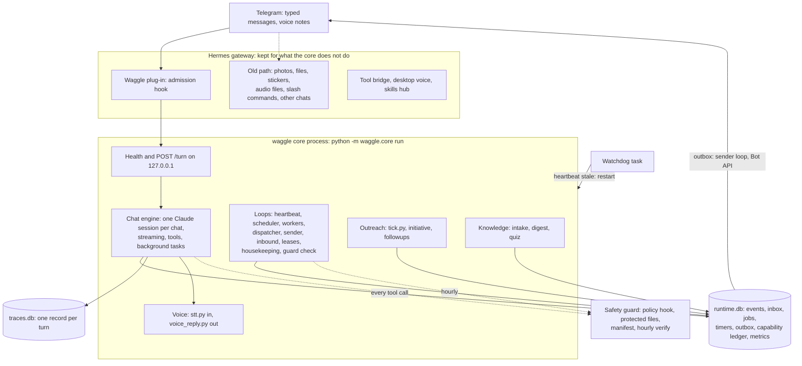

# Waggle

Waggle is a personal assistant for one person, written in Python and running on that person's own Windows PC.
The owner talks to it by typing or by voice note in Telegram; it answers with Claude, keeps notes in a local
Obsidian vault, and messages first when something deserves it (a morning brief, a reminder, a follow-up).
It is a working personal project that was rebuilt around its own always-on process, not a framework or a
product, and this file claims only what the code and the tests show.

Where the facts come from: the code, `overnight/HANDOFF.md` (what is live and proven, 2026-11-20) and
`overnight/REBUILD_PLAN.md` (the design and build order). Numbers are quoted from those files or from a test
run, and the source is named next to each. `docs/ARCHITECTURE.md` describes an earlier design (a Hermes plug-in
with a router); this file replaces it as the description of the current one.

## Architecture



- **Core process** (`waggle/core/`): started at logon by Task Scheduler. It owns one SQLite store, `runtime.db`
  (WAL mode): events (append-only), inbox, jobs with leases, timers with a catch-up policy each, the outbox,
  a capability ledger and daily metrics. Its loops are listed in the `waggle/core/runtime.py` docstring.
- **Engine** (`waggle/chat_engine.py`): one user message in, one reply out. It knows nothing about Telegram; a
  transport hands it a delivery object. Claude answers in a long-lived per-chat session, streamed by editing
  one message about every 1.2 s. If Claude is unavailable the reply says so. The small local model answers
  only when a caller passes it explicitly. Heavy work becomes a background job.
- **Outbox**: every outgoing message is a row before any transport sees it. A row becomes `sent` only with the
  provider's message id, retries back off, and the same idempotency key never creates a second row. A possible
  duplicate is preferred over a lost message.
- **Voice**: speech-to-text is local (faster-whisper, run inside the core). The reply is a spoken answer of at
  most 3 sentences and 45 words (`voice_reply.py`, local Kokoro speech, Ogg/Opus) followed by the full text.
- **Outreach** (`waggle/tick.py`): a look pass every 5 minutes, a morning brief, an evening note, reminders and
  follow-ups as one-shot timers, and a reasoning step that decides whether anything is worth saying. A reminder
  asked for by voice is delivered as a one-sentence voice note first, then the text.
- **Knowledge** (`waggle/knowledge_core.py`): intake every 30 minutes, digest at 21:00 and 08:00, quiz at 21:30.
  It learns only from turns whose recorded origin is `user`; tests, benches, the CLI and agents are never used.
- **Hermes gateway**: still receives Telegram, hands typed messages and voice notes to the core through its
  admission hook (Hermes never starts a turn for them), and still answers photos, files, stickers, audio files,
  captions, slash commands and other chats. It also provides the tool bridge, desktop voice and the skills hub.

## How a message travels

Typed message: Telegram, gateway, plug-in admission hook, `POST /turn` on the core (127.0.0.1, bearer token),
inbox row, inbound loop (one thread per chat, a chat's messages in arrival order), `chat_engine.run_turn`,
Claude streams into the delivery, final text, trace record. If delivery fails, the reply goes to the outbox
with the key `turn:<id>` and the sender loop delivers it once.

Voice note: the same path, but the audio is transcribed first (with the owner's project names as a hint). The
model is asked for a `SPOKEN:` part and an `ANSWER:` part in one turn, the spoken part is synthesised while the
answer is still being written, and the voice message goes out before the text. If speech fails or runs past its
15 s budget, the text goes out alone and the reason is recorded (`voice_reply.py` docstring).

Every turn leaves a record in `traces.db`: origin, who really answered, timings, each tool call with its result
(redacted, 500 characters), delivery result and message ids, claims, outcome and code version.

## How it stays up

- Task Scheduler runs "Waggle Core" at logon (restart on failure) and "Waggle Core Watchdog", one long-lived
  process that checks every 10 s and sleeps in between, so nothing starts every minute and nothing flashes a
  window (`waggle/core/control.py`). A third task starts the gateway (`tools/install-gateway-task.ps1`).
- Start-up order: single-instance lock, database, plug-ins, guard check, job recovery, outbox recovery, timer
  catch-up. The PC is shut down at night, so a timer found past due fires late and says it was late.
- Crash recovery: a running job whose recorded process is gone is requeued; a live detached worker is
  re-adopted by the next core; a message stuck in `sending` goes back to `queued`. Process identity is pid plus
  creation time, because Windows reuses pids.
- Measured on the real machine (HANDOFF): core killed, back in 57 s; core frozen, replaced in 51 s by the older
  watchdog. The newer loop watchdog is tested (worst case about 85 s) but not re-measured live.

## Safety model

- **Protected files** (`waggle/guard.py`): the policy, the hook, approvals, budget limits and the guard's own
  data are listed as data. A write to them becomes a one-time approval for the owner. The hook hashes the
  checked files against a manifest on every call and refuses everything on a mismatch (it fails closed); the
  core re-verifies hourly. The manifest lives outside the repository, per checkout. The learned budget
  estimate is clamped to 0.1x to 4x of the owner's own value.
- **Approval rules** (`waggle/policy.py`): every tool call of a Claude agent passes a PreToolUse hook. Reading,
  web search and edits inside the project folders run on their own. Money, secrets, messaging or posting as the
  owner, deleting their data, system settings, writing outside the roots and system-wide installs need a yes:
  the call is denied with a short code, and `approve <code>` grants exactly that call once. Disabling security,
  piping downloads into a shell and reading credential stores are never allowed.
- **What is recorded**: every turn (`traces.db`), every state change (`runtime.db` events), approval decisions,
  and the origin of everything. Secrets are redacted from traces and logs.
- **Origins**: a turn is `user`, `test`, `canary`, `bench` or `agent`. Only `user` may feed facts, the digest,
  the quiz or reminders. This exists because early on 50 of the first 78 recorded turns were development
  prompts and one was filed as a fact about the owner (plan, decision 10).
- **Four known open holes**, kept as strict expected-failure tests in `tests/test_guard.py` so whoever closes
  one sees its test flip: (1) `python -m waggle.guard` puts the working folder first on the import path;
  (2) code that runs at interpreter start-up (`sitecustomize`, a `.pth` line) can run before the checks;
  (3) any code an agent may run as the same Windows user can rewrite a protected file and the manifest together;
  (4) processes other than the hook import normally, so a poisoned module can change what they do. The guard
  docstring says only privilege separation (a manifest the owner's account cannot write) closes the third.

## How it is tested

- Run with `python -m pytest -q -p no:cacheprovider`. On this branch the last full run was 1298 passed, 2 skipped, 4 xfailed in 3 min 46 s (my own
  run; one real-process timing test failed once while the machine was busy and passed on re-run). The plan
  recorded 550 passing tests when the core was first integrated, so the suite has grown since.
- It includes real-process tests: they start a real core (`python -m waggle.core run`) in a temporary home,
  kill it mid-job, freeze it, and check that the watchdog replaces it (`tests/test_runtime_core.py`).
- Tests never touch the real Waggle home (an autouse fixture redirects it), never call Ollama or Claude unless
  a test opts in with a fake, and can never reach the real Telegram: `telegram.real_api_allowed()` is false
  under pytest and for any home other than the real one, and child processes inherit that.
- Every child process needs no-window handling, checked by `tests/test_no_window_calls.py`, because a visible
  window is a user-facing defect.
- The screen probe (`tools/window_probe.py`, Windows, standard library and ctypes) records windows, focus
  changes, the busy cursor and process starts. `tools/flicker_check.py` runs the core, watchdog, jobs and a
  chat turn under it. HANDOFF records a live run of 242 process starts with no visible window, focus change or
  busy cursor from Waggle's processes.
- Passing tests is not the finish line: `overnight/USER_TESTS.md` lists checks only the owner can do on the real
  phone, and `tools/decision_check.py` runs the outreach decision step on made-up findings.

## Status

| Area | Status | Evidence or gap |
|---|---|---|
| Core, watchdog, crash recovery | Live and proven | Kill and freeze measured on the machine (HANDOFF) |
| Typed turns and voice notes through the engine | Live and proven | Answered on real Telegram; two real voice replies delivered (2.8 s and 14.2 s of audio) |
| No visible windows from Waggle's processes | Live and proven | Probe run, 242 process starts (HANDOFF) |
| GitHub CLI from the gateway | Live and proven | Private repositories listed (HANDOFF) |
| Removing a false fact from every store | Live and proven | Done for one fact learned from a test prompt (HANDOFF) |
| Reminders | Live but unproven in full | One asked by voice fired on time and was delivered, as text, and was missed. Voice-first delivery is in code and tests, not yet seen live |
| Outreach judgement (what to say, when) | Live but unproven | No real-model evidence: the real check was refused by Waggle's own budget check |
| Knowledge intake, digest, quiz | Live but unproven | Scheduled; HANDOFF records no real result |
| Chat session context | Live, known wrong | Carried a stale belief about GitHub; fresh session per day not built |
| Background work budget | Live, design open | Deferred while the 5-hour window reads above 60%, shared with every Claude session |
| Phone calls | Code exists, not proven | Readiness comes only from the capability ledger |
| Single "Waggle off" command | Not built | `core stop` does not pause the watchdog |
| End-to-end test client | Not built | Plan step 5; needs the owner's one-time Telegram login |
| Closed learning loop | Not built | Plan step 7 |
| Cron jobs moved to core timers | Built | `waggle/duties_core.py`; `install.py` removes the Hermes entries (backup of jobs.json) |
| Evaluation suites, autonomous work, self-edits | Not built | Plan steps 11 to 13 |

## Install and run (Windows)

Requirements: Windows 11, Python 3.11 or newer (developed on 3.14), the Claude Code CLI signed in, Hermes Agent
installed (the gateway side), and a Telegram bot token in `TELEGRAM_BOT_TOKEN` (environment or the Hermes env
file). Waggle has no third-party Python dependencies (`pyproject.toml`); speech and the vault use local tools
that are already on the owner's machine. Steps that exist in this repository:

```
python install.py                                  # plug-in into Hermes (re-run when hermes_plugin/ changes)
powershell -ExecutionPolicy Bypass -File tools\install-core-task.ps1 -WhatIf   # preview core + watchdog tasks
powershell -ExecutionPolicy Bypass -File tools\install-core-task.ps1           # register them
powershell -ExecutionPolicy Bypass -File tools\install-gateway-task.ps1        # gateway at logon
python -m waggle.guard approve --yes               # record the protected-file manifest (the owner's step)
python -m waggle.guard verify
python -m waggle.core status                       # also: run | stop | restart | watch
python -m waggle.cli doctor                        # health check
python -m pytest -q -p no:cacheprovider
```

Remove the core tasks with `tools\install-core-task.ps1 -Uninstall`. `overnight/HANDOFF.md` has the full deploy
procedure. Merging to the checkout that runs is a deploy, so development happens in separate worktrees.

## Lessons from the build (from the handoff and plan)

- Never run CPU-saturation tests on the machine that runs the live core.
- Development tests never touch the live home and can never reach the real Telegram.
- A visible window is a defect; every child process needs the no-window handling.
- Files written under AppData from inside a packaged app are private to that app; check what an outside
  process sees before trusting a file.
- A worker's report is not evidence: run the suite, read the records, prove it on the real interface.
- Ask the records what happened: `traces.db`, `runtime.db` and the chat's Claude session file.
- "Ready" must come from a recorded success, never from configuration being present (plan, decision 4).
- Early versions counted a turn as fine when only the code ran: all 75 early trace rows said ok while real task
  success was 3 of 13 (plan, audit table). The current turn record exists to prevent that.
