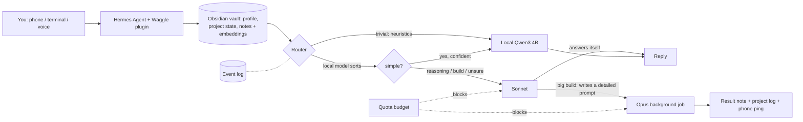

# Waggle 🐝

A personal AI agent that runs on my own PC, keeps track of my projects, talks to me first when
something matters, and decides for every message **which brain should handle it**:

- a **free local model** (Qwen3-4B-Instruct-2507, 64k context, on an RTX 5070) sorts every request and handles simple ones,
- **Claude Sonnet** for real reasoning, borderline calls, and checking anything the local model wants to tell me,
- **Claude Opus** as a **background builder** for big jobs ("build me an app for a nonprofit"), pinging my phone when done.

It never burns through my Claude Pro limit: it measures real usage across all my Claude sessions and keeps a budget.

> Named after the honeybee *waggle dance*: how a bee tells the hive where to go. Routing, basically.

## How a message flows



## Project awareness

Every project has a structured note in `Projects/`: goal, current focus, open problems, next actions
(Obsidian checkboxes), decisions, resources and a dated log. "Where were we with BIOBUZZ?" is answered from
that note, not by rereading old chats. Build jobs write to their project's log when they start and finish.

## Proactive, but not annoying

An hourly Hermes cron job (script only, no LLM in Hermes) runs `waggle/proactive.py`:

1. **Free watchers**: unpushed commits, old uncommitted work, projects with no progress for a week.
2. **Local review**: the local model reviews one project per run and proposes at most two insights.
3. **Verification**: anything "important" or "critical" must survive a Sonnet check (max 4 per day, budget-gated).
4. **Delivery by tier**:

| Tier | What happens |
|---|---|
| Critical | Phone now, even at night |
| Important | Mentioned the next time I talk to Waggle |
| Interesting | Twice-daily digest (one Sonnet call filters out generic AI suggestions) |
| Low confidence | Logged, never shown |

Findings are deduplicated for a week. Replying `useful <id>` / `not useful <id>` is logged as feedback.

## Voice (all local, free)

| Piece | Engine | Notes |
|---|---|---|
| Wake word "hey jarvis" | sherpa-onnx open-vocabulary keyword spotting | No training; any phrase works |
| Push-to-talk | Hermes voice mode, `Ctrl+B` | Silence detection ends the recording |
| Speech-to-text | faster-whisper `small` | Also transcribes Telegram voice notes |
| Spoken replies | Piper `en_GB-alan-medium` | Sentence-by-sentence streaming |

**Waggle Voice.bat** opens a small window that listens for the wake word (it also starts minimized at login).
Voice turns go through the same Waggle brain: routing, memory, project state and live data.

## Learning about you

Only the user's own words are mined for facts (never the assistant's replies or search results). Personal
details (home, school, grade, schedule, places) go to **Profile > About me**, where single-value details
replace their old line; likes, dislikes and preferences go to their own notes. Everything stays in the local
Obsidian vault and can be edited by hand.

## Event log = benchmark data

Every route decision, Claude call, build job, finding, notification and piece of feedback goes to
`~/.waggle/events.jsonl`. `waggle_status` reports local share, routing latency, job success rate and the
"useful" rate of proactive suggestions, the raw material for the Phase 5 benchmark.

## Modules

| Module | What it does |
|---|---|
| `router.py` | Heuristics, then local sort (simple / reasoning / build / unsure), then Sonnet for non-simple; local fallback when Claude is unavailable |
| `quota.py` | Reads every Claude Code transcript on the PC to measure the 5-hour window; Waggle's share is capped at 30%; learns the real limit from actual limit hits |
| `claude_cli.py`, `jobs.py` | Lean headless `claude -p` on the Pro login (no API key); detached Opus builds that resume after a limit reset |
| `vault.py`, `memory.py` | Obsidian vault + `nomic-embed-text` embeddings in SQLite; each turn gets the profile and the most relevant notes |
| `projects.py` | Structured project state, tasks, logs, project detection in messages |
| `proactive.py` | Watchers, local review, Sonnet verification, tiered delivery, digest, weekly profile consolidation |
| `learn.py` | Per-turn personal facts (likes, dislikes, preferences) with dedupe; weekly Sonnet profile rewrite |
| `notify.py` | Desktop toast, next-message queue, phone via `hermes send`; quiet hours 23:00 to 07:00 |
| `events.py` | Append-only event log + summary stats |
| `security.py` | Untrusted-content wrapping, prompt-injection scan, approval for messaging/money/destructive commands |
| `hermes_plugin/waggle/` | Hooks + tools: `vault_search`, `remember`, `start_build`, `build_status`, `waggle_status`, `project_status`, `project_update`, `rate_finding` |

Built on [Hermes Agent](https://github.com/NousResearch/hermes-agent) (agent loop, gateway, cron, Telegram)
instead of reinventing it. The cost-aware routing idea comes from [OpenJarvis](https://github.com/open-jarvis/OpenJarvis).

## Setup (Windows)

1. Install [Ollama](https://ollama.com), then:
   ```
   ollama pull qwen3:4b-instruct-2507-q4_K_M
   ollama pull nomic-embed-text
   ollama create waggle-4b -f ollama/Modelfile.waggle-4b
   ```
2. Install Hermes Agent with `HERMES_HOME` outside AppData (the Microsoft Store Claude app redirects AppData writes).
3. `python install.py`: creates the vault, installs the plugin, points Hermes at the local model.
4. Double-click **Waggle Login.bat** and type `/login` (Claude CLI sign-in).
5. Double-click **Setup Phone.bat**: Telegram bot + allowlist, cron jobs, gateway on every login.
6. Double-click **Start Waggle.bat** for the terminal chat.

## Tests

```
python -m pytest -q      # 56 tests: routing, local sort, quota, memory, projects, proactive tiers, digest filter, git watch, jobs, guardrails
```

## Roadmap

- **Phase 3 (done):** voice: "hey jarvis" wake word (sherpa), Ctrl+B push-to-talk, faster-whisper, Kokoro replies
  (British voice, kept warm so a reply is ~0.8 s); phone calls via Twilio: verified critical alerts (max 2/day,
  never in quiet hours) and "call me in 10 minutes about X". One-time setup: `Setup Calls.bat`.
- **Phase 4 (screen):** "what's this error on my screen?" -> screenshot -> local vision model (gemma4 in Ollama,
  nothing leaves the PC) -> answer. Screen control is Hermes's `computer_use` (cua-driver); Waggle adds a
  guardrail so acting in banking, password, settings or messaging apps, or typing anything that looks like a
  password, card number or key, needs your OK.
- **Phase 4:** screen: on-request screenshots read by a local vision model, mouse/keyboard control, background watching
- **Phase 5:** budgeted specialist roles (sequential, not parallel) + the Waggle benchmark (success, quality, quota, latency, autonomy, reliability, proactivity)
- **Phase 6:** a small Jarvis panel on top of Hermes's dashboard: live jobs, quota, project status

## Honest limits

- The always-on brain is a 4B model, much weaker than Claude. That is why it escalates, and why its proactive ideas must pass Sonnet.
- Hermes needs 64k context; Qwen3-8B tops out at 40,960, so the 4B 2507 model (256k native) is the always-on brain.
- Pro limits aren't published; the budget is an estimate that improves with every real limit hit.
- When the PC is off, live chat and the proactive loop are off.
