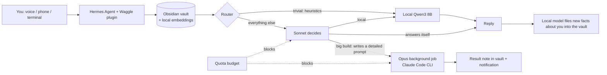

# Waggle 🐝

A personal AI agent that runs on my own PC and decides, for every message, **which brain should handle it**:

- a **free local model** (Qwen3 8B on an RTX 5070) for quick stuff,
- **Claude Sonnet** for real reasoning, which it also uses to judge every non-trivial request,
- **Claude Opus** as a **background builder** for big jobs ("build me an app for a nonprofit"), pinging me when done.

It remembers me through an **Obsidian vault**, learns my likes and dislikes as we talk, and never burns
through my Claude Pro limit: it measures real usage and keeps a budget.

> Named after the honeybee *waggle dance*: how a bee tells the hive where to go. Routing, basically.

## How a message flows



## What's in Phase 1 (this release)

| Piece | File | What it does |
|---|---|---|
| Router | `waggle/router.py` | Instant heuristics for trivial requests; Sonnet picks local/sonnet/opus **and** answers or writes the build prompt in the same call; local fallback when Claude is unavailable |
| Quota budget | `waggle/quota.py` | Reads every Claude Code transcript on the PC (my own sessions too) to measure the current 5-hour window; Waggle may use at most 30%; learns the real limit from actual limit hits |
| Claude hand-off | `waggle/claude_cli.py`, `waggle/jobs.py` | Lean headless `claude -p` calls on the Pro login (no API key); Opus builds run detached, resume automatically after a limit reset |
| Memory | `waggle/vault.py`, `waggle/memory.py` | Obsidian vault (Me / Projects / Journal / Ideas / People / Jobs); notes embedded with `nomic-embed-text` into SQLite; each turn gets the profile plus the most relevant notes |
| Learning | `waggle/learn.py` | After every turn the local model extracts durable facts (deduped by embedding similarity); `waggle consolidate` has Sonnet rewrite the profile |
| Guardrails | `waggle/security.py` | Web/email/file text is wrapped as untrusted and scanned for prompt injection; messaging, money and destructive commands always need my OK; Opus jobs get hard rules |
| Hermes plugin | `hermes_plugin/waggle/` | Hooks (`pre_llm_call`, `post_llm_call`, `pre_tool_call`) + tools (`vault_search`, `remember`, `start_build`, `build_status`, `waggle_status`) |

Built on [Hermes Agent](https://github.com/NousResearch/hermes-agent) (agent loop, memory, gateway, cron) instead of
reinventing it. The cost-aware routing idea comes from [OpenJarvis](https://github.com/open-jarvis/OpenJarvis)
(local-first, efficiency as a first-class metric).

## Setup (Windows)

1. Install [Ollama](https://ollama.com), then:
   ```
   ollama pull qwen3:8b
   ollama pull nomic-embed-text
   ollama create waggle-8b -f ollama/Modelfile.waggle-8b
   ```
2. Install Hermes Agent with `HERMES_HOME` outside AppData (the Microsoft Store Claude app redirects AppData writes).
3. `python install.py`: creates the vault at `~/WaggleVault`, installs the plugin, points Hermes at the local model.
4. `python -m waggle.cli login`: sign the Claude CLI in once (type `/login`).
5. Double-click **Start Waggle.bat**.

Useful commands: `python -m waggle.cli status | search "..." | route "..." | jobs | consolidate | reindex`.

## Tests

```
python -m pytest -q      # 34 tests: routing, quota math, vault search, learning, guardrails, jobs
```

## Roadmap

- **Phase 2:** proactive loop (local model gathers ideas all day, Sonnet picks the good ones), Telegram/Discord on my phone with a sender allowlist, weekly profile consolidation on a schedule
- **Phase 3:** voice: wake word (openWakeWord), push-to-talk, faster-whisper, Piper replies; phone calls via Twilio
- **Phase 4:** screen: on-request screenshots read by a local vision model, mouse/keyboard control, background watching
- **Phase 5:** dashboard + benchmark: local vs Sonnet vs Opus on my own tasks, accuracy vs Pro quota used

## Honest limits

- The always-on brain is an 8B model; it is much weaker than Claude. That is why it escalates.
- Pro limits aren't published; the budget is an estimate that improves with every real limit hit.
- When the PC is off, live chat is off. Scheduled jobs can run on GitHub Actions.
